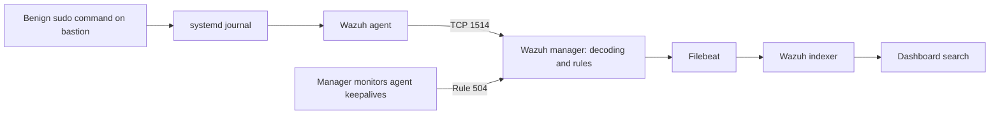

# First Wazuh agent: delivery, interruption and recovery

Evidence date: **28 October 2026**. This is a public summary of tests in the original laboratory. It uses role names and omits operating addresses, identities, exact event times, access details and full records. Example addresses elsewhere in this repository are illustrative, not the endpoints used in these tests.

**Result:** the central Wazuh stack and one Debian bastion agent were deployed. A benign administrative event reached the dashboard, orderly stops and starts were detected, and a controlled loss of the agent's network path generated a disconnection alert. Fresh activity was received after connectivity was restored. **This validates the first agent, not the complete P1 gate.**

## Scope and evidence

The operator supplied command outputs and dashboard screenshots during a guided session. They include local journal records, service state, manager agent state, structured alerts, the temporary filter counter and indexed dashboard results. The documentation author reviewed those supplied records; this is not an independent remote audit.

The all-in-one server runs on Ubuntu Server 24.04 LTS with 4 vCPU, 8 GiB allocated memory and a 300 GB virtual disk as reported by the hypervisor. It uses the SOC segment. The first agent runs on the existing Debian bastion in MGMT. The original package versions and installation integrity record are retained privately. Short service checks do not establish sustained capacity or retention compliance.

## Telemetry path

This is an explanatory architecture. Matching source records and indexed alerts demonstrate the end-to-end samples below; packet-by-packet tracing of every internal hop was not performed. The Linux agent collects journald directly; no extra authentication log file was added for this test.

## Test matrix

| Check | Method and observed result | Scope and limit |
|---|---|---|
| Central service readiness | Indexer, manager, Filebeat and dashboard reported active; dashboard login succeeded. | Point-in-time readiness, not a long-running availability or capacity test. |
| First agent onboarding | Debian agent appeared active under the expected role and matched the selected manager release. | One agent and one routed MGMT-to-SOC path; other zones are untested. Enrollment trust hardening has not been established by this test. |
| Source-to-dashboard delivery | A unique marker was printed through sudo. The journal recorded the command; a dashboard hit matched agent, marker and rule **5402**, level **3**, “Successful sudo to ROOT executed.” | Benign authorized administration, not proof of privilege escalation by an attacker. |
| Orderly stop and manual restart | Stopping the agent produced **506**, “Wazuh agent stopped.” Restarting it produced **503**, “Wazuh agent started.” Both appeared in the dashboard. | The service stop explicitly differs from silent network loss. |
| Scheduled restart | A transient systemd timer started the stopped agent. Its journal showed execution and successful completion; a corresponding **503** alert was indexed. | This recovery job was observed to execute. It is separate from the later network rollback timer. |
| Activity after restart | A new marker generated indexed **5402** alerts. Two results had different source times and sudo process IDs. | Those two records are separate command invocations, not an identical event duplicated in this sample. This is not a general deduplication audit. |
| Silent network-path interruption | A dedicated temporary nftables table dropped only agent traffic to the manager's TCP 1514. The agent service remained active and the drop counter increased. The manager generated **504**, level **3**, “Wazuh agent disconnected.” The dashboard indexed it. | One intentional endpoint filter, not an OPNsense policy change or a test of every failure mode. |
| Connectivity restoration | The temporary table was deleted; the manager again reported the agent active. A newly generated marker then appeared as **5402** alongside the **504** event in the dashboard. | Demonstrates new delivery after restoration. Does not prove complete buffering, losslessness, replay ordering or historical recovery during the outage. |
| Cleanup | No nftables tables remained in the checked endpoint ruleset. The agent was active and the network rollback timer reported inactive. | End-of-test state in this sample. A stopped transient timer need not remain listed. |

## Why the interruption test was designed this way

An initial search for rule 504 overlooked the **506** alerts already produced by orderly service stops. The reviewed records distinguish agent stop, agent start and missed communication. A controlled path interruption was then tested with the agent running.

The Wazuh manager had to remain available throughout. Turning off the workstation hosting both the manager and the agent cannot demonstrate that the manager detects its peer's absence while it is itself offline. An additional startup later in the day is recorded as a startup; its cause was reported by the operator, not reconstructed from the alert alone.

Before blocking traffic, the endpoint ruleset was checked and found empty. A dedicated temporary table was used with an accepting default policy and a single destination-and-port-specific drop. Administrative SSH used a different port and stayed available. The experiment did not flush an existing ruleset, alter OPNsense, stop the agent, or add a persistent boot-time policy.

A separate transient timer was armed before the filter was added to remove only that test table after 40 minutes. The filter was manually removed once the disconnection was observed, and the timer was cancelled. Its automatic firing was therefore **not** tested. This must not be confused with the earlier service restart timer, which did execute successfully.

Wazuh's documented default disconnection threshold is 15 minutes; periodic checks can affect the observed alert time. The one recorded alert arrived approximately 18 minutes after the post-application reference reading. That reference was not an exact timestamp of the first dropped packet, so this is not a detection-latency SLA or a precise measurement from the last keepalive.

## Interpretation

Rules 503, 504 and 506 describe different lifecycle events. A process can be running locally while its manager considers it disconnected. Conversely, the manager reporting an agent active does not by itself prove that a new application event reached the index; the post-restoration marker provides that additional evidence.

MITRE ATT&CK and compliance labels are rule metadata. They do not establish an attack or certify compliance. These experiments were authorized administrative and availability checks.

The result supports a limited P1 source-health demonstration: one agent's communication loss was detected, recovery was observed, and a new event reached the searchable dashboard. It does not establish continuous detection of every silent log source or an external monitoring service for a failed manager.

## Remaining P1 work

- Onboard the additional Windows/Linux roles and implement the required endpoint auditing and legitimate service activity.
- Prepare the firewall syslog receiver before enabling R07; then demonstrate receipt, decoding, indexing and source health. Agent reception does not imply UDP syslog reception is configured.
- Complete the data contract, reusable samples and detection fixtures.
- Implement and verify the accepted index and archive retention, protected exports, retrieval and deletion behavior.
- Measure representative multi-source resource use, storage growth, time stability and failure/recovery behavior.
- Complete the remaining client, zone, DNS/DHCP/DoH, transport and isolation checks.
- Preserve recovery material and test restoration. A new post-installation snapshot has not been demonstrated.
- Review enrollment identity verification, dashboard certificate trust and coordinated component updates without treating the current sample as proof of those controls.

## References

- [Private-information publication policy](publication-policy.md).
- [P1 readiness](../infra/p1-preflight.md) and [network deployment summary](../infra/p1-network-start.md).
- [Wazuh agent rules, exact tested release](https://github.com/wazuh/wazuh/blob/v4.14.9/ruleset/rules/0015-ossec_rules.xml).
- [Wazuh disconnection settings](https://documentation.wazuh.com/current/user-manual/reference/ossec-conf/global.html#agents-disconnection-time).
- [Monitoring implementation, exact tested release](https://github.com/wazuh/wazuh/blob/v4.14.9/src/monitord/monitord.c).
- [Wazuh architecture](https://documentation.wazuh.com/current/getting-started/architecture.html).
- [Journald collection](https://documentation.wazuh.com/current/user-manual/capabilities/log-data-collection/journald.html).
